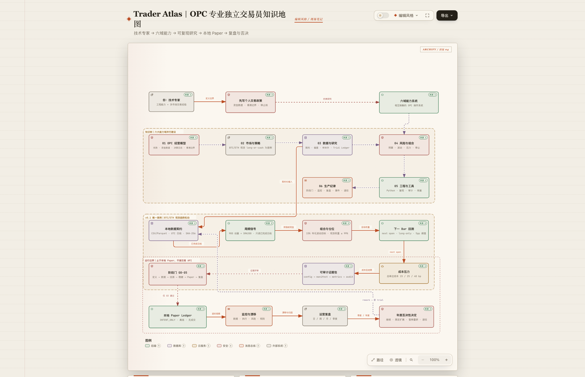

# Trader Atlas

> 面向技术专家的 OPC 专业独立交易员知识树：以香港法域、BTC/ETH 现货趋势轮动和本地 paper ledger 为首条可验证路径。

> [!CAUTION]
> 本项目用于研究、教育与工程验证，不构成投资、法律或税务建议，不承诺盈利。数字资产可能损失全部本金；任何实际交易前都应重新核验所在地法规、平台牌照、产品准入和个人风险预算。

[](https://github.com/fomos-openai/trader-atlas/actions/workflows/ci.yml)
[](https://fomos-openai.github.io/trader-atlas/)

## 一眼看懂

[](https://fomos-openai.github.io/trader-atlas/knowledge-map/)

- [在线交互知识地图](https://fomos-openai.github.io/trader-atlas/knowledge-map/) · [仓库内 HTML](00-knowledge-map.html)
- [90/180/365 日快速路线](docs/paths/03-roadmap-90-180-365.md)
- [BTC/ETH 现货趋势轮动案例](docs/case/btc-eth-spot-trend/index.md)
- [下载《Trader Atlas》PDF 小书](output/pdf/trader-atlas.pdf)
- [浏览完整知识库](https://fomos-openai.github.io/trader-atlas/)

## 最短可行路径

项目把“稳定收益”改写为可验证、可否决的工程目标：

1. **0–30 天：先活下来。** 写清资金隔离、现金跑道、香港合规边界、风险预算和停止条件。
2. **31–60 天：只研究一件事。** 用同一数据契约验证 BTC/ETH 现货 long-or-cash 周频策略，记录每次试验。
3. **61–90 天：冻结候选。** 完成成本、样本外、稳健性与故障测试；失败就拒绝，不回看 holdout 包装成成功。
4. **91–270 天：本地 paper。** 连续记录至少 26 个周度决策点，核对信号、意向订单、现金和事故。
5. **271–365 天：做一次否决性评审。** 只在流程可靠、风险在预算内且证据仍成立时，讨论下一版小资金验证。

全职投入可以加速学习和工程，不能压缩真实市场证据所需的日历时间。

## 六大知识域

| 知识域 | 回答的问题 | 必须产物 |
|---|---|---|
| [OPC 经营模型](docs/knowledge/01-opc-operating-model/index.md) | 如何从技术管理者转型而不把生活押在回测上？ | 交易政策、现金跑道、决策日志 |
| [市场与策略](docs/knowledge/02-markets-and-strategies/index.md) | 交易什么、为什么可能有边际、成本和托管风险是什么？ | 市场/策略选择矩阵 |
| [数据与研究](docs/knowledge/03-data-and-research/index.md) | 如何避免前视、幸存者偏差和参数挖掘？ | 数据契约、trial ledger、样本外报告 |
| [风险与组合](docs/knowledge/04-risk-and-portfolio/index.md) | 如何把“不爆仓”写成可执行约束？ | 风险预算、仓位规则、压力测试 |
| [工程与工具](docs/knowledge/05-engineering-and-tools/index.md) | 如何让研究、回测和 paper 使用同一逻辑？ | 可复现环境、审计账本、测试 |
| [生产纪律](docs/knowledge/06-production-discipline/index.md) | 如何监控、复盘、暂停和退役策略？ | 阶段门、事故复盘、退役记录 |

## 可运行案例

案例仅消费本地 CSV/Parquet，不连接交易所，也不会发送订单。

```bash
uv sync --all-groups
uv run trader-atlas validate-data --data tests/fixtures/btc-eth-daily-synthetic.csv
uv run trader-atlas research \
  --config configs/btc-eth-spot-trend.yml \
  --data tests/fixtures/btc-eth-daily-synthetic.csv
uv run trader-atlas paper \
  --config configs/btc-eth-spot-trend.yml \
  --data tests/fixtures/btc-eth-daily-synthetic.csv
```

运行结果写入未跟踪的 `artifacts/runs/<run-id>/`。合成数据只验证实现与不变量，不能证明策略盈利；真实研究应导入计划使用场所的数据，并保留来源、时间、品种映射和校验和。

## 内容状态与证据规则

- `draft`：结构完整，但仍可能缺少来源或复核。
- `reviewed`：完成同行式复核与内部一致性检查。
- `verified`：事实与链接已在 `last_reviewed` 日期重新核验；不代表投资结论正确。
- 监管、费率、产品准入和平台名单必须带 `as_of`/`review_due`，不得写成永久事实。
- 路径页负责组织学习顺序，不复制知识正文；小书只提炼决策框架，并用稳定链接回到仓库。

## 贡献与许可

纠错与内容缺口请使用 Issue 模板；提交前阅读 [CONTRIBUTING.md](CONTRIBUTING.md)。代码、脚本和配置采用 [MIT](LICENSE)，原创文档、地图与小书采用 [CC BY 4.0](LICENSE-CONTENT)，具体边界见 [LICENSING.md](LICENSING.md)。第三方数据和素材不因进入本项目而获得再许可。

版本：`v0.1.0` · 更新日期：2026-10-01
